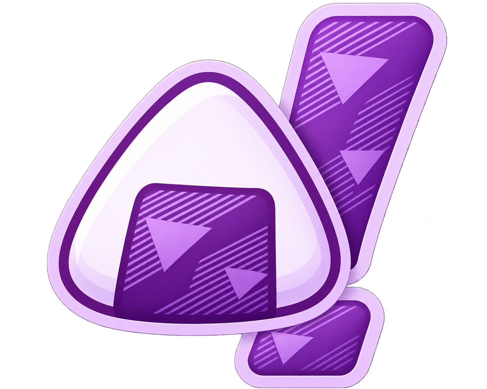

# Pokemon Showdown: Okayu Update



**Desarrollado con asistencia extensa de IA (OpenAI Codex), bajo la dirección del mantenedor.** Consulta [la declaración de uso de IA](AI_DISCLOSURE.md) y [las pruebas realizadas](docs/VALIDATION.md).

Gestor externo de modificaciones reversibles para [Pokémon Showdown Pro](https://github.com/Ryukotsuki/PokemonShowdownPro).

**Versión alfa para Linux. Compatible únicamente con la distribución extraída de Pro 1.2.0 cuyos archivos coincidan con el adaptador.** No es una versión oficial de Showdown, Showdex ni Showdown+.

El gestor instala módulos sobre la aplicación original. No sustituye su interfaz por otro cliente ni mantiene un segundo motor de combate. Guarda los respaldos fuera de la instalación y permite volver a los archivos originales.

## Módulos

| Módulo | Función |
| --- | --- |
| Modo cine optimizado | Corrige la realimentación del observador de cambios, reduce trabajo de estilos y retrasa el cálculo de paneles plegados. |
| Botón de avisos | Permite ocultar/restaurar el recuadro narrativo y los avisos de habilidades, conservando el log. |
| Tema Okayu | Paleta violeta y rosa que hereda Pro, con el logo Okayu en la ventana, el cliente, Battle Hub y el acceso propio del menú. |
| Showdown+ | Adaptación de Showdown+ 1.4 a Electron. Requiere importar el XPI oficial. |
| Idiomas de Calcdex | Sigue el idioma de Showdown, usa sus nombres/descripciones y añade controles en español, con respaldo a inglés. |

La conexión común de módulos se instala automáticamente. Showdown+ usa el cliente nuevo. Calcdex sigue usando los IDs y datos originales para los cálculos.

## Inicio rápido

Requisitos: Linux, Python 3.10 o posterior y el **AppImage original o una distribución extraída** de Pokémon Showdown Pro 1.2.0. Para los diálogos gráficos instala Zenity mediante tu distribución. La primera compilación de Calcdex necesita conexión para obtener sus dependencias. Se utiliza el runtime Node que incluye Pro.

1. Descarga el proyecto y descomprímelo en una carpeta propia.
2. Cierra la instalación de Showdown que vas a modificar.
3. Ejecuta `sh Okayu-Update.sh`.
4. Selecciona **Instalar / cambiar módulos**. El gestor detecta Showdown Pro mediante sus accesos del menú, procesos principales y ubicaciones habituales. Si encuentra una única opción, no pide buscar carpetas.
5. Si usas AppImage, confirma **Preparar**. El gestor crea automáticamente una instalación fija y conserva el archivo original. Si no detecta ninguna aplicación, puedes elegir directamente el AppImage que descargaste.
6. Elige los módulos. Showdown+ se selecciona por separado y solicita su XPI oficial 1.4.
7. Espera a que termine la compilación e instalación; se muestra una ventana de progreso. Abre **Pokemon Showdown: Okayu Update** desde el menú de aplicaciones.

La distribución `.tar.gz` extraída de Pro se modifica directamente. Si tienes un AppImage, **Instalar / cambiar módulos** prepara automáticamente una distribución en `$XDG_DATA_HOME/pokemon-showdown-okayu-update/managed/` (por defecto, `~/.local/share/pokemon-showdown-okayu-update/managed/`). No necesitas saber dónde están los archivos internos. Se conserva el AppImage intacto. Esta alfa **no vuelve a empaquetar ni modifica el AppImage comprimido**. Después de instalar, el acceso **Pokemon Showdown: Okayu Update** abre la distribución modificada. El acceso anterior del AppImage sigue abriendo el original. También puedes elegir **Abrir aplicación** en el gestor.

No selecciones nuestra antigua copia experimental ni una instalación modificada manualmente: las huellas deben coincidir con la base original. El gestor conserva el perfil normal de la aplicación. Los módulos no copian perfiles, equipos, cookies ni credenciales.

El módulo Okayu también instala el logo proporcionado por el mantenedor en el icono nativo de la ventana, Battle Hub, la cabecera de Showdown y el acceso propio del menú. Los logos forman parte de la instalación del módulo, aunque cambies temporalmente de paleta; se restauran al revertir o retirar ese módulo. El acceso y el icono globales de la aplicación original se conservan. El AppImage original comprimido no cambia.

El tema Okayu aparece en las opciones de tema de Showdown después de reiniciar. El botón «Textos» aparece junto a los controles de combate. Los idiomas de Calcdex siguen las preferencias de Showdown.

La búsqueda evita listar procesos de Electron o recorrer todo el disco. Ignora los montajes temporales `/tmp/.mount_…` y la antigua copia experimental. Recuerda la instalación preparada para las próximas veces. Los detalles extensos de extracción y dependencias se guardan en registros locales en lugar de imprimirse en la terminal.

## Línea de comandos

Desde cualquier carpeta, usando la ruta al script:

```sh
sh ./Okayu-Update.sh discover
sh ./Okayu-Update.sh prepare /ruta/a/PokemonShowdownPro.AppImage
```

La interfaz gráfica realiza estos pasos sin comandos adicionales. Para operaciones avanzadas sobre una distribución ya preparada:

```sh
sh ./Okayu-Update.sh status /ruta/a/ShowdownPro
sh ./Okayu-Update.sh plan /ruta/a/ShowdownPro
sh ./Okayu-Update.sh apply /ruta/a/ShowdownPro
sh ./Okayu-Update.sh revert /ruta/a/ShowdownPro
```

Para incluir Showdown+:

```sh
sh ./Okayu-Update.sh apply /ruta/a/ShowdownPro \
  --modules performance,battle-messages,theme-okayu,showdown-plus,calcdex-languages \
  --xpi /ruta/a/pokemon_showdown_plus-1.4.xpi
```

Obtén el paquete de [su página oficial en Mozilla](https://addons.mozilla.org/firefox/addon/pokemon-showdown-plus/). Esta alfa verifica el SHA-256 de la versión 1.4: `d128d2e8703bbe8d6a38141ee8591a37acd26c99003d788f1ccfc019b876030c`.

`plan` comprueba los cambios previstos sin modificar la instalación. `apply` sin `--modules` instala rendimiento, avisos, Okayu e idiomas. Puedes cambiar la selección ejecutando de nuevo `apply`; primero se reconstruye virtualmente la base respaldada, para no acumular parches.

## Respaldos, reversión y actualizaciones

Los registros y respaldos se guardan en `$XDG_DATA_HOME/pokemon-showdown-okayu-update`, o en `~/.local/share/pokemon-showdown-okayu-update`. No borres esa carpeta si necesitas revertir. Se puede seleccionar otra con `--data`.

Cada modificación comprueba las huellas originales y guarda los bytes anteriores. La reversión se detiene si un archivo cambió externamente. Un fallo de escritura intenta deshacer la transacción; una interrupción del proceso deja un registro recuperable:

```sh
sh ./Okayu-Update.sh recover /ruta/a/ShowdownPro
```

Después de una actualización, vuelve a ejecutar el gestor. **Esta alfa no promete compatibilidad automática con versiones futuras**: rechazará una versión o unos archivos desconocidos sin aplicar parches. Los adaptadores y módulos permanecen separados de la aplicación, para publicar una revisión compatible sin rehacer el paquete completo.

Nunca se restaura una versión antigua encima de una nueva. Una reinstalación limpia de una versión ya compatible puede modificarse de nuevo. Si hay una actualización parcial o ediciones ajenas, el gestor se detiene para conservarlas.

Okayu y el módulo de idiomas recompilan el Showdex 1.4.2 que incluye Pro 1.2.0 y lo sirven desde `build/okayu-update-showdex`. Mientras estén instalados, esa compilación tiene prioridad sobre las generaciones del actualizador nativo de Showdex. Para adoptar una versión nueva de Showdex hace falta validar y actualizar el adaptador; revertir devuelve la selección de recursos original.

## Reportar un problema tras una actualización

Usa **Issues → Incompatibilidad tras actualizar** e indica qué módulos seleccionaste y qué observaste. Puedes generar un diagnóstico:

```sh
sh ./Okayu-Update.sh diagnose /ruta/a/ShowdownPro > okayu-diagnostic.json
```

El diagnóstico contiene versiones, estado, nombres de archivos del programa y huellas. No incluye rutas absolutas, datos del perfil ni contenido de conversaciones. Revisa cualquier captura o registro de compilación antes de publicarlo; esos archivos pueden contener rutas locales.

## Documentación técnica

- [Arquitectura y transacciones](docs/ARCHITECTURE.md).
- [Pruebas y alcance de validación](docs/VALIDATION.md).
- [Desarrollo con IA](AI_DISCLOSURE.md).
- [Guía de contribución](CONTRIBUTING.md).

## Desarrollo y alcance

```sh
python3 -m unittest discover -s tests -v
```

Los módulos declaran sus archivos, huellas y cambios exactos en `modules/*/addon.json`. `compatibility/1.2.0.json` identifica los originales admitidos. El gestor no ejecuta instaladores arbitrarios descargados por módulos: aplica los paquetes locales de este repositorio y, cuando procede, ejecuta el compilador de Showdex con dependencias fijadas y scripts de instalación desactivados.

Para desarrollo se puede reutilizar un checkout de Showdex 1.4.2 con sus dependencias mediante `--showdex-source /ruta/al/checkout`. Ese parámetro es una fuente de código confiada por el desarrollador, no un mecanismo de descarga verificada.

Windows, macOS, actualizaciones automáticas del gestor y reconstrucción de AppImage quedan fuera de esta primera alfa.

## Licencias y autoría

El código propio del gestor y las adaptaciones derivadas de Pro se distribuyen bajo AGPL-3.0-or-later. Se conserva la licencia de Pro. Consulta [THIRD_PARTY_NOTICES.md](THIRD_PARTY_NOTICES.md). Los recursos de Showdown+ no se incluyen ni cambian de licencia: se importan localmente desde el paquete oficial. Pokémon y sus recursos conservan sus titulares y licencias correspondientes.
